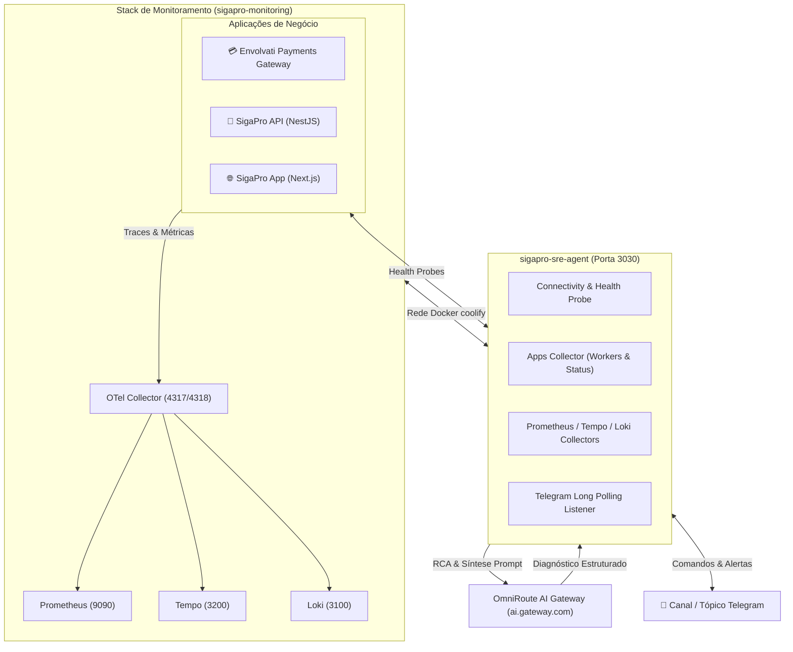

# 🤖 SigaPro SRE AI Agent

Agente inteligente de Site Reliability Engineering (SRE) e AIOps para o ecossistema SigaPro e Envolvati Payments Gateway. O agente monitora a saúde das **Aplicações de Negócio** e da **Infraestrutura de Observabilidade**, correlaciona telemetria distribuída via **Prometheus, Grafana Tempo e Loki**, e utiliza o **OmniRoute AI Gateway (`ai.gateway.com`)** para diagnósticos automatizados, respostas em linguagem natural e resumos executivos interativos no Telegram.

---

## 📡 Origem dos Dados (Observabilidade)

Este agente não armazena métricas nem logs brutos. Toda a telemetria consumida pelo agente é coletada, ingerida e indexada pela stack central do repositório vizinho:

👉 **[envolvati/sigapro-monitoring](https://github.com/envolvati/sigapro-monitoring)**

* **Prometheus** (`http://prometheus:9090`): Métricas de latência (p95/p99), volume e taxa de erro 5xx.
* **Grafana Tempo** (`http://tempo:3200`): Traces distribuídos OpenTelemetry e árvores de spans.
* **Grafana Loki** (`http://loki:3100`): Indexação e busca de logs e exceções estruturadas.
* **OTel Collector** (`otlp:4317 / 4318`): Pipeline de ingestão central dos microsserviços.

A comunicação entre o `sigapro-sre-agent` e os monitores acontece internamente através da rede Docker `coolify`, garantindo **baixa latência (< 30ms)** e **isolamento total sem portas expostas na internet**.

---

## 🏗 Arquitetura



---

## 💬 Comandos Interativos do Bot no Telegram

O agente executa um **Listener Long-Polling nativo** (zero necessidade de webhook público ou portas abertas). No canal/tópico configurado, o bot escuta e responde interativamente aos seguintes comandos:

| Comando | Descrição | Exemplo de Uso |
| :--- | :--- | :--- |
| **`/apps`** *(ou `/services`)* | Painel consolidado das **Aplicações de Negócio** (Gateway, API e App) com latência, status e contagem de workers ativos. | `/apps` |
| **`/app <nome>`** | Raio-X individual da aplicação solicitada. Mostra os 7 workers do Gateway ou os últimos logs de erro da API. | `/app payments`<br>`/app sigapro` |
| **`/snapshot <pergunta>`** *(ou `/sre`)* | **Diagnóstico com IA em Linguagem Natural**: cruza métricas do Prometheus, logs do Loki e status das aplicações com o OmniRoute AI Gateway para responder qualquer dúvida técnica. | `/snapshot como tá o envolvati payments?`<br>`/snapshot a api caiu? O que os logs mostram?` |
| **`/trace <trace_id>`** | Busca a árvore de spans no Grafana Tempo e gera a Análise de Causa Raiz (**RCA**) via IA, identificando o span culpado por timeout ou erro. | `/trace 4bf92f3577b34da6a3ce929d0e0e4736` |
| **`/digest`** | Dispara sob demanda o **Daily SRE Digest** com o resumo executivo das últimas 24h (volume, uptime, p95 e anomalias). | `/digest` |
| **`/health`** *(ou `/status`)* | Executa um probe em tempo real medindo a conectividade e latência interna de cada monitor (Prometheus, Tempo, Loki e OmniRoute). | `/health` |
| **`/help`** *(ou `/start`)* | Exibe o menu formatado com a lista de comandos e exemplos no chat. | `/help` |

---

## 💻 Comandos via Terminal (CLI)

Além do bot interativo, você pode disparar rotinas diretamente do terminal (local ou via SSH na VPS):

```bash
# Dispara o Daily SRE Digest e envia para o Telegram:
pnpm digest

# Executa o diagnóstico de um Trace ID no terminal:
pnpm analyze <TRACE_ID>
```

---

## 🌐 Endpoints HTTP do Servidor (Porta `:3030`)

- `GET /health` — Retorna o JSON com o relatório de latência de cada monitor e da infraestrutura.
- `POST /triggers/daily-digest` — Endpoint para agendadores (Cron do Coolify) dispararem o resumo diário automaticamente (ex: todo dia às 08:00 BRT).
- `POST /webhooks/grafana` — Receptor de alertas configurável no **Grafana Alerting** ou **GlitchTip** para disparar análises automáticas de incidentes.
- `POST /analyze/trace/:traceId` — Endpoint REST para solicitar análise de traces por outros microsserviços.

---

## 🚀 Como Rodar Localmente

### 1. Instalar dependências
```bash
pnpm install
```

### 2. Configurar variáveis de ambiente
Copie `.env.example` para `.env` e configure suas credenciais:
```bash
cp .env.example .env
```

```env
PORT=3030
NODE_ENV=development

# OmniRoute AI Gateway (ai.sigapro.com)
AI_GATEWAY_URL=https://ai.gateway.com/v1
AI_GATEWAY_KEY=sua_key_omniroute
AI_MODEL=sre/triage-combo

# Stack de Observabilidade (http://localhost se via túnel, ou nomes docker na VPS)
PROMETHEUS_URL=http://localhost:9090
TEMPO_URL=http://localhost:3200
LOKI_URL=http://localhost:3100

# Aplicações Monitoradas
PAYMENTS_GATEWAY_URL=https://gateway.example.com
SIGAPRO_API_URL=https://api.example.com
SIGAPRO_APP_URL=https://app.dasboard.com

# Telegram
TELEGRAM_BOT_TOKEN=seu_bot_token
TELEGRAM_CHAT_ID=-100xxxxxxxxxx
TELEGRAM_THREAD_ID=284
```

### 3. Rodar em desenvolvimento
```bash
pnpm dev
```

---

## 🐳 Deploy no Coolify

O projeto já contém `Dockerfile` multi-stage e `docker-compose.yml` pré-configurado na rede `coolify`:

1. No Coolify, adicione como **New Application** apontando para o repositório Git.
2. Defina o build pack como **Docker Compose**.
3. Adicione as variáveis de ambiente de produção no painel.
4. Execute o Deploy. O container subirá na porta `3030` conectado automaticamente à rede dos monitores.
