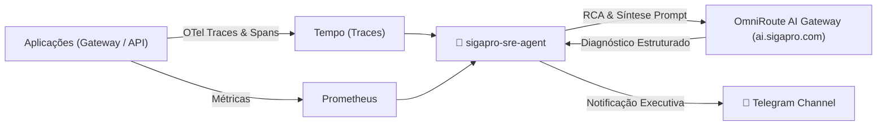

# 🤖 SigaPro SRE AI Agent

Agente inteligente de Site Reliability Engineering (SRE) e AIOps que correlaciona telemetria do **OpenTelemetry (Tempo, Prometheus, Loki)** e utiliza o **OmniRoute AI Gateway (`ai.sigapro.com`)** para diagnosticar incidentes, identificar gargalos e publicar resumos executivos no Telegram.

---

## 🎯 O que este agente faz?

1. **Daily SRE Digest (Proativo)**:
   - Coleta métricas das últimas 24h (taxa de 5xx, latência p95/p99 e volume).
   - Envia um resumo executivo diário para o canal de SRE/Releases no Telegram.
2. **Incident Flash RCA (Reativo)**:
   - Recebe alertas disparados pelo **Grafana Alerting** ou **GlitchTip** via Webhook.
   - Puxa o **Trace Distribuído** no Grafana Tempo, analisa a árvore de spans e identifica com precisão o componente culpado (ex: lentidão no PSP externo vs lock de banco local).
   - Posta o diagnóstico imediato no Telegram.
3. **Análise Sob Demanda via CLI**:
   - Permite que qualquer desenvolvedor investigue um Trace ID específico direto do terminal: `pnpm analyze <trace_id>`.

---

## 🏗 Arquitetura



---

## 🚀 Como Rodar Localmente

### 1. Instalar dependências
```bash
pnpm install
```

### 2. Configurar variáveis de ambiente
Copie `.env.example` para `.env` e ajuste as credenciais:
```bash
cp .env.example .env
```

### 3. Rodar em desenvolvimento
```bash
pnpm dev
```

### 4. Testar comandos via CLI
```bash
# Disparar o Daily Digest imediatamente:
pnpm digest

# Analisar um Trace ID específico:
pnpm analyze 4bf92f3577b34da6a3ce929d0e0e4736
```

---

## 🌐 Endpoints da API

- `GET /health`: Healthcheck do agente.
- `POST /triggers/daily-digest`: Dispara a rotina do resumo diário.
- `POST /webhooks/grafana`: Receptor de webhooks do Grafana Alerting.
- `POST /analyze/trace/:traceId`: Executa a análise de um trace sob demanda.
