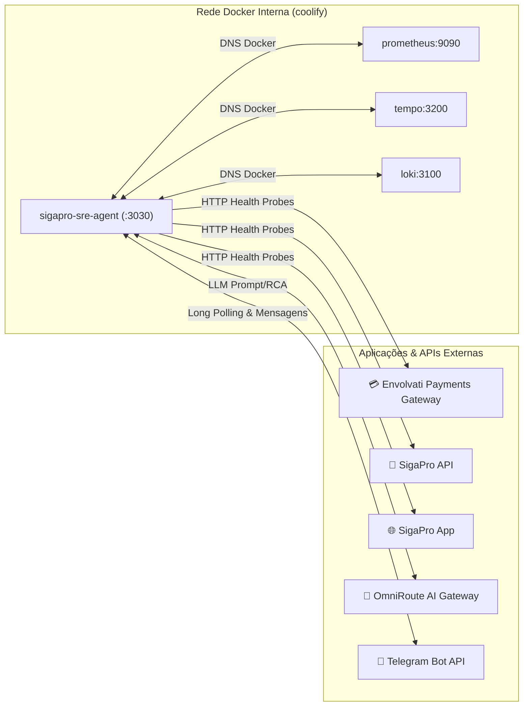

# 📖 Runbook Operacional — SigaPro SRE AI Agent

Este documento é o guia de referência operacional para manter, configurar e diagnosticar o container **`sigapro-sre-agent`** em produção e homologação.

---

## 🎯 Visão Geral do Serviço

* **Nome no Coolify:** `sigapro-sre-agent`
* **UUID do Recurso no Coolify:** `8r5ajcud3ckolxggk9vsnliz`
* **Projeto / Ambiente:** `Sigapro` / `monitor`
* **Repositório Git:** `https://github.com/envolvati/sigapro-sre-agent`
* **Branch de Deploy:** `main`
* **Porta Interna:** `3030`
* **Rede Docker:** `coolify` (rede externa compartilhada)

---

## 🌐 Topologia de Rede & Integrações



---

## ⚙️ Variáveis de Ambiente (Configuração Obrigatória)

> ⚠️ **Atenção (Repositório Open-Source):**
> No código-fonte (`src/config/env.ts`), os valores default para URLs das aplicações monitoradas são marcados propositalmente com placeholders genéricos (`https://payments.domain.com`, `https://api.domain.com`, `https://app.domain.com`) para evitar vazamento de endpoints privados.
> **Portanto, as variáveis de negócio DEVEM ser declaradas explicitamente nas Environment Variables do Coolify.**

### Tabela Completa de Configuração

| Variável | Obrigatória | Valor em Produção / Staging | Finalidade |
| :--- | :---: | :--- | :--- |
| **`PORT`** | Não | `3030` | Porta onde o servidor Fastify responde. |
| **`NODE_ENV`** | Sim | `production` | Modo de execução do Node.js. |
| **`AI_GATEWAY_URL`** | Sim | `https://ai.sigapro.com/v1` | URL base do OmniRoute AI Gateway. |
| **`AI_GATEWAY_KEY`** | Sim | `sk-...` | API Key para autenticação no OmniRoute. |
| **`AI_MODEL`** | Sim | `sre/triage-combo` | Modelo LLM utilizado para Daily Digest e RCA. |
| **`PROMETHEUS_URL`** | Sim | `http://prometheus:9090` | Acesso interno ao Prometheus na rede `coolify`. |
| **`TEMPO_URL`** | Sim | `http://tempo:3200` | Acesso interno ao Grafana Tempo na rede `coolify`. |
| **`LOKI_URL`** | Sim | `http://loki:3100` | Acesso interno ao Grafana Loki na rede `coolify`. |
| **`PAYMENTS_GATEWAY_URL`** | **SIM** | `https://hml-payments.envolvati.com` | URL do gateway de pagamentos para aferição do `/health` e workers. |
| **`SIGAPRO_API_URL`** | **SIM** | `https://api.sigapro.com` | URL do backend da API SigaPro para health check. |
| **`SIGAPRO_APP_URL`** | **SIM** | `https://app.sigapro.com` | URL do frontend SigaPro para checagem de uptime. |
| **`TELEGRAM_BOT_TOKEN`** | Sim | `8198199909:...` | Token do bot emitido pelo @BotFather. |
| **`TELEGRAM_CHAT_ID`** | Sim | `-1002295540132` | ID do grupo/canal do Telegram. |
| **`TELEGRAM_THREAD_ID`** | Opcional | `10141` | ID do Tópico do fórum no Telegram (se aplicável). |

---

## 🚀 Como Configurar no Coolify

1. Acesse o painel do Coolify: `http://localhost:8000` (ou domínio público configurado).
2. Navegue até o projeto: **Sigapro** ➔ Ambiente **monitor** ➔ Aplicação **`sigapro-sre-agent`**.
3. Vá na aba **Environment Variables**.
4. Certifique-se de que todas as variáveis da tabela acima estejam preenchidas (especialmente `PAYMENTS_GATEWAY_URL`, `SIGAPRO_API_URL` e `SIGAPRO_APP_URL`).
5. Clique em **Save** e em seguida em **Redeploy**.

---

## 🛠 Comandos de Operação via SSH (VPS Oracle)

O acesso ao servidor é feito via `ssh oracle` com permissões `sudo su`:

### 1. Verificar se o container está rodando
```bash
sudo docker ps --filter "name=sre-agent"
```

### 2. Acompanhar logs em tempo real
```bash
sudo docker logs -f --tail 100 $(sudo docker ps -q --filter "name=sre-agent")
```

### 3. Verificar variáveis carregadas no container em execução
```bash
sudo docker exec $(sudo docker ps -q --filter "name=sre-agent") env | grep -E 'URL|AI|TELEGRAM'
```

### 4. Testar o endpoint de saúde do próprio agente
```bash
curl -s http://localhost:3030/health | jq .
```
*Retorno esperado:* HTTP `200` com status `UP` para `prometheus`, `tempo`, `loki` e `aiGateway`.

### 5. Reiniciar o serviço manualmente
```bash
sudo docker restart $(sudo docker ps -q --filter "name=sre-agent")
```

---

## 🩺 Playbooks de Diagnóstico (Troubleshooting)

### 🔴 Problema 1: Bot reporta serviços como DOWN no Telegram (Falso Positivo)

* **Sintoma:** Ao rodar `/apps`, `/digest` ou `/snapshot`, o bot responde com `❌ Envolvati Payments Gateway: DOWN` ou `❌ SigaPro API: DOWN`, mas os serviços estão funcionando no navegador.
* **Causa Raiz:** O container está sem as variáveis `PAYMENTS_GATEWAY_URL`, `SIGAPRO_API_URL` ou `SIGAPRO_APP_URL` e usou os fallbacks `*.domain.com`.
* **Como Validar:**
  ```bash
  sudo docker exec $(sudo docker ps -q --filter "name=sre-agent") node -e '
    console.log("PAYMENTS:", process.env.PAYMENTS_GATEWAY_URL);
    console.log("API:", process.env.SIGAPRO_API_URL);
    console.log("APP:", process.env.SIGAPRO_APP_URL);
  '
  ```
  Se retornar `undefined`, as variáveis não foram injetadas pelo Coolify.
* **Resolução:**
  1. Adicione as variáveis na aba *Environment Variables* do Coolify.
  2. Clique em **Redeploy**.

---

### 🔴 Problema 2: O Bot não responde a comandos no Telegram

* **Sintoma:** O usuário envia `/help` ou `/apps` no Telegram e nada acontece.
* **Causa Raiz:** 
  1. Conflito de chat/tópico: a mensagem foi enviada fora do `TELEGRAM_CHAT_ID` ou de um tópico diferente de `TELEGRAM_THREAD_ID`.
  2. Falha de rede no Long Polling da API do Telegram.
* **Como Validar:**
  Procure por logs de entrada do listener:
  ```bash
  sudo docker logs --tail 200 $(sudo docker ps -q --filter "name=sre-agent") | grep -E "TelegramListener|Incoming command"
  ```
* **Resolução:**
  1. Verifique se o `TELEGRAM_CHAT_ID` e `TELEGRAM_THREAD_ID` coincidem exatamente com o canal/tópico onde o bot foi invocado.
  2. Reinicie o container: `sudo docker restart $(sudo docker ps -q --filter "name=sre-agent")`.

---

### 🔴 Problema 3: Conectividade DEGRADED com a Stack de Observabilidade

* **Sintoma:** O `/health` retorna `status: DEGRADED` acusando `PROMETHEUS`, `TEMPO` ou `LOKI` como `DOWN`.
* **Causa Raiz:** Os containers da stack de observabilidade (`sigapro-monitoring`) caíram ou não estão conectados na mesma rede Docker `coolify`.
* **Como Validar:**
  ```bash
  # Testar resolução interna de DNS docker
  sudo docker exec $(sudo docker ps -q --filter "name=sre-agent") node -e '
    fetch("http://prometheus:9090/-/healthy").then(r => console.log("Prometheus:", r.status)).catch(console.error);
    fetch("http://tempo:3200/ready").then(r => console.log("Tempo:", r.status)).catch(console.error);
    fetch("http://loki:3100/ready").then(r => console.log("Loki:", r.status)).catch(console.error);
  '
  ```
* **Resolução:**
  Verifique se o compose `sigapro-monitoring` está ativo no Coolify ou suba-o novamente.

---

### 🔴 Problema 4: Falha ao gerar Daily Digest ou RCA de Trace

* **Sintoma:** O bot acusa `❌ Erro ao consultar AI Gateway`.
* **Causa Raiz:** A chave `AI_GATEWAY_KEY` expirou/está incorreta, o endpoint `AI_GATEWAY_URL` está inacessível ou o modelo `sre/triage-combo` não existe no catálogo.
* **Como Validar:**
  ```bash
  sudo docker exec $(sudo docker ps -q --filter "name=sre-agent") node -e '
    fetch(process.env.AI_GATEWAY_URL + "/models", {
      headers: { Authorization: "Bearer " + process.env.AI_GATEWAY_KEY }
    }).then(r => console.log("AI Gateway status:", r.status)).catch(console.error);
  '
  ```
* **Resolução:** Atualize `AI_GATEWAY_KEY` ou aponte `AI_MODEL` para um modelo alternativo como `auto/fast`.

---

## ⏰ Rotinas Automáticas (Scheduled Tasks no Coolify)

Para disparar o **Daily SRE Digest** automaticamente todos os dias às **08:00 BRT** (11:00 UTC):

1. No Coolify, em `sigapro-sre-agent` ➔ **Scheduled Tasks**.
2. Nome: `Daily SRE Digest`.
3. Cron Expression: `0 11 * * *` (ou `0 8 * * *` se o timezone do servidor for BRT).
4. Comando a executar:
   ```bash
   curl -X POST http://localhost:3030/triggers/daily-digest
   ```
