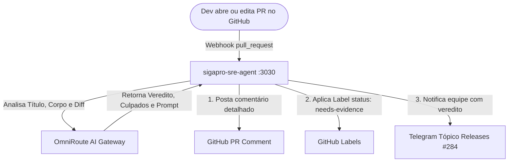

# SigaPro SRE Copilot — PR Gatekeeper & Quality Auditor

O **PR Gatekeeper** é o módulo do `sigapro-sre-agent` responsável por auditar Pull Requests abertos no GitHub contra os padrões de qualidade, convenções de commits e evidências obrigatórias de validação da Envolva TI.

---

## 1. Como Funciona



---

## 2. Régua de Avaliação (Rubric)

A IA audita o PR com base nos seguintes pilares:

1. **Padrão de Título (Conventional Commits):**
   * Deve seguir estritamente: `tipo(escopo): descrição` (ex: `fix(subscriptions): ...`, `feat(docker): ...`, `chore(deps): ...`).
2. **Motivação & Contexto:**
   * **Bugs:** Deve explicar claramente o que estava quebrado antes.
   * **Features:** Deve descrever o novo comportamento introduzido.
3. **Evidências de Validação (Obrigatórias):**
   * **Testes Unitários/E2E:** Não basta marcar `[x] Testes`. Deve haver evidência textual (ex: contagem de testes passando, log de execução).
   * **Type Check & Lint:** Confirmação explícita de `tsc --noEmit` ou `oxlint` limpos.
   * **Build:** Confirmação de compilação sem erro.
   * *Se faltar evidência textual, o PR é classificado como `NEEDS_WORK`.*
4. **Impacto e Dependências:**
   * Se arquivos como `package.json`, `go.mod` ou `Dockerfile` foram alterados, o PR deve justificar as alterações de infra/dependência.

---

## 3. Configuração no GitHub

### 3.1 Webhook do Repositório
No repositório do GitHub (`sigapro`, `sigapro-api` ou `envolvati-payments-gateway`):
1. Vá em **Settings** → **Webhooks** → **Add webhook**.
2. **Payload URL:** `https://sre.sigapro.com/webhooks/github` (ou o IP/porta do agente `http://<HOST>:3030/webhooks/github`).
3. **Content type:** `application/json`.
4. **Which events would you like to trigger this webhook?**
   * Selecione **Let me select individual events**.
   * Marque apenas **Pull requests**.
5. Clique em **Add webhook**.

### 3.2 Token de Acesso (GITHUB_TOKEN)
Para que o SRE Agent consiga postar comentários e aplicar labels nos PRs:
1. No GitHub, gere um Personal Access Token (PAT) com escopo `repo` (ou `pull_requests: write`, `issues: write`).
2. No painel do Coolify → aplicação `sigapro-sre-agent` → **Environment Variables**, adicione:
   ```env
   GITHUB_TOKEN=ghp_seu_token_aqui
   ```

---

## 4. Endpoints Disponíveis no SRE Agent

### `POST /webhooks/github`
Endpoint receptor de webhooks nativos do GitHub para eventos de `pull_request` (`opened`, `edited`, `synchronize`).

### `POST /analyze/pr`
Endpoint para auditoria sob demanda (pode ser chamado via CLI, scripts ou localmente):

```bash
curl -X POST http://localhost:3030/analyze/pr \
  -H "Content-Type: application/json" \
  -d '{
    "repository": "envolvati/sigapro-api",
    "pullNumber": 116,
    "title": "fix(docker): upgrade Node to 26 and set flexible engines to remediate CVEs",
    "body": "Descrição com checklist...",
    "author": "wjunior",
    "baseBranch": "main",
    "headBranch": "staging"
  }'
```
